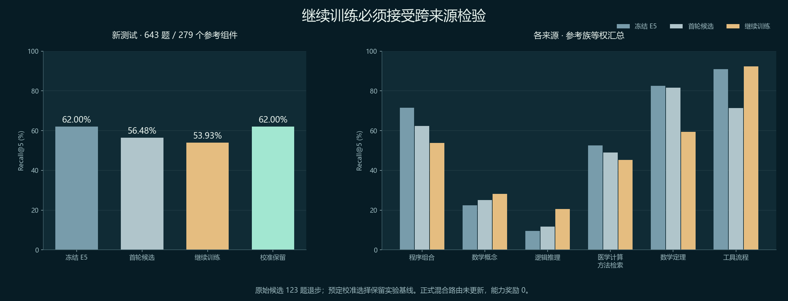

# 继续训练与作用范围：第二轮研究结果

2026-10-14。先将首轮完整实现、数值候选、四组检查点和复现脚本推送 main（`8a5f34edbdac0f635a6b5ef7ce50da52243669ef` / complete.19），再从 GitHub 全新克隆，12,650 个交付文件逐字节一致、1,881 个技能和同一候选正常加载。本轮继续开展独立来源实验，并将验证后的范围保护和研究对照落地。

本轮结论：**继续训练没有带来通用路由提升；拒绝失败更新的机制有效运行。个人偏好在已学范围内生效，超出范围时保留原检索。** 不把保留基线称作新模型进步，不把虚拟用户实验称作真实用户收益。

## 研究依据

[SRA-Bench / SR-Agents](https://github.com/oneal2000/SR-Agents) 区分检索、技能引入和最终执行，提供六个任务族及标注技能。它为本轮提供不同于首轮 Gym / SkillRouter 的参考来源，但路由召回仍不能证明任务执行成功。

[Learning without Forgetting](https://arxiv.org/abs/1606.09282) 提供保留旧知识的蒸馏思路。本轮比较固定 E5 教师的表示与分布保留约束，并未复现其完整视觉模型实验，也不保证该方法适用于技能路由。

[Learn then Test](https://arxiv.org/abs/2110.01052) 启发“先训练、独立校准、再测封存样本”的分工。本轮使用预声明的混合强度网格、二项风险上界及多重比较校正；参考族的独立可交换性仍是假设，不能直接宣称获得任意分布漂移下的统计保证。

## 数据与冻结协议

固定 SRA commit：`277fd8d2bbd7d3b81a5cf4ffa6e87e18c7906e4f`。读取 5,400 个实例与 26,262 个候选，核验数据文件 SHA-256；没有安装或执行上游代码。标注目标 636 项，另按 ID 哈希选取 1,024 个干扰项，共 1,660 项缩减候选池。原始数据不随仓库重新分发。

联合表示包含首轮 2,043 节点与 SRA 1,660 节点，共 3,703 节点。各来源在自身固定候选池中评价，没有把不同池的分数混作一个检索成绩。

相同规范化问题和相同参考技能集合连接为组件，组件整组分区。TheoremQA 与 BigCodeBench 整个来源只作外部测试；其余四族分训练、验证、校准和测试。检查了与首轮 Gym 及 SkillRouter 问题的精确重合，排除已检查 schema 的两条问题。这不证明语义完全独立。

| 分区 | 问题数 | 用途 |
| --- | ---: | --- |
| 训练 | 786 | 原 Gym 训练 106 + 新来源 680；唯一进入梯度的任务问题 |
| 验证 | 298 | 检查点与六组候选选择 |
| 校准 | 303 | 固定强度网格的拒绝／保留分析；不进入梯度 |
| 新测试 | 643 | 四族 343 + 两个整来源 300；选定模型和校准决定后评价 |
| 旧测试诊断 | 32 | 首轮已经暴露，仅作回归诊断，不算新的独立证据 |

新测试含 279 个参考组件。公开技能正文属于传导式输入；参考包标签不是最少必要技能或因果贡献的真值。

协议 SHA-256：`3890372b4282733b866e030da03c222fd9ccb14786b5507953b4830dec896152`。
特征 SHA-256：`1e10c87499473f32460b9507dedd0e06b4e34552da57b1696a9278ed49925236`。

本轮在编码和训练前冻结原奖励政策指纹、训练代码、统计代码、父权重、来源、分区及选择规则。首轮历史协议未被改写。

## 实际继续训练

父权重固定为首轮 `network-b9e7622390ddc716`。冻结 E5 编码器，更新 query / skill 低秩投影的 73,728 个活动参数；完整架构 110,596 参数，图消息不启用。

各训练来源等权，多正例 InfoNCE 加可选的 query / skill 余弦表示保留及冻结教师分布 KL。保留系数 0、1、4，随机种子 17、29，共六组；学习率 0.001、批次 32、最多 40 轮。检查点按验证集来源／参考族等权 Recall@5 选择，同分保留更早轮次。

最终选择 `retention-4-seed-17` 的 epoch 2，模型 `network-b747f23c038d5521`。其验证指标从父候选 35.5156% 到 35.5338%，仅有很小变化。另五组的最佳验证检查点仍是训练前父候选。损失持续下降伴随验证退步，说明过拟合明显。

本机实际使用 RTX 4050 / CUDA。训练流程记录 53.27 秒，不包括数据下载和 CPU 文本编码。保存全部六组权重和完整曲线，不只保留一个“赢家”。

## 新测试结果



以下为同一 643 题、同一固定候选池下的问题平均 Recall@5：

| 方案 | Recall@5 | 相对冻结 E5 |
| --- | ---: | ---: |
| 冻结 E5 | 62.00% | 基线 |
| 首轮候选 | 56.48% | −5.52 个百分点 |
| 继续训练候选 | 53.93% | −8.07 个百分点 |
| 校准后的保留策略 | 62.00% | 0；选择保留基线 |

原始新候选 43 题提高、123 题退步、477 题持平。按来源／参考组件等权的指标为基线 54.95%、新候选 49.93%。两种聚合方式均显示通用迁移失败。

下表按各来源内参考族等权计算，与上表的问题平均口径不同：

| 来源 | 冻结 E5 | 首轮候选 | 继续训练 |
| --- | ---: | ---: | ---: |
| 程序组合 BigCodeBench | 71.56% | 62.36% | 53.88% |
| 数学概念 CHAMP | 22.44% | 25.00% | 28.21% |
| 逻辑推理 LogicBench | 9.60% | 11.74% | 20.50% |
| 医学计算方法检索 | 52.59% | 48.98% | 45.21% |
| 数学定理 TheoremQA | 82.60% | 81.56% | 59.44% |
| 工具流程 ToolQA | 90.94% | 71.36% | 92.36% |

局部进步不能授权通用更新。本轮不根据已经看过的新测试重调权重、阈值或来源范围。

## 校准和十二门实际做了什么

原协议预声明强度 0 / 0.25 / 0.5 / 0.75 / 1；非零强度用 Bonferroni 校正的二项上界检查参考组件发生退步的风险，且要求校准问题没有观察到退步。达不到条件就取 0。校准结论在新测试评价前写入文件，实际取值为 **0**。

独立实现重新读取真实权重和全部新测试参考，逐条复算原始与受控排序两次。两次确定性复算不增加独立样本数。

原十二门研究审计 **9/12**，阻断项为增益、可靠性及一次性版本奖励凭证。受控策略零退步源于保留基线，增益也为零。该候选没有自动替换产品混合路由，能力奖励为 0。研究门的检查不能替代执行产物、成本和因果贡献的验收。

风险上界的假设边界和“零失败也未必有足够证据”已加入测试。没有将相似度、模型评分或训练损失当成奖励依据。

## 已落地的个人作用范围保护

个人训练协议升级为 `private-preference-training-v2`：

- 只用明确的 A 优于 B 偏好训练，至少两道不同训练问题；同一道问题的两组偏好不冒充两道样本。
- 仅训练问题的表示组成作用范围，留出问题不进入支持向量。
- 预声明余弦阈值 0.88；相似度不足时保持当前个人检索，页面解释本次未应用适配的原因。
- 与当前问题足够相似的训练经验，可将其明确比较过的方法加入个人候选池，避免偏好的方法被共享 top-20 截断。附加方法数有上限。
- 旧候选继续保留，缺少范围检查的旧版本需要重新训练。当前配置、正文、编码器或权重不匹配时拒绝使用。
- 个人历史版本可在页面恢复，恢复生成新版本。范围拒绝不删除个人候选，用户仍可撤回手动选择。

两个虚拟用户继续使用同一 16 条合成偏好，各 9 训练 / 7 留出。相反偏好仍产生相反排序，Excel 偏好留出匹配 0/7 → 7/7；四个预先选定的 GPU、数学、OAuth 和轨道问题，在两个空间中都落在范围外，原排序保留。这是 **4 个探针在两个空间的复查**，不是 8 个独立问题，也不是真实用户研究。

实际冻结编码器和完整产品目录还通过隔离的 FastAPI ASGI 路径完成：反馈 → 梯度训练 → 手动选择 → 熟悉问题生效 → 无关问题保持原排名 → 撤回 → 历史恢复。共享权重和原技能库物理字节均不变。

该范围阈值是保守的相似度规则，尚未证明它能识别所有错误迁移，不能解释为成功概率或能力证书。

## 产品与复现

`/personal` 可切换首轮与第二轮通用候选，查看各来源结果、全部消融、校准保留决定和十二门证据。权重、模型 ID 与研究协议必须和报告一致，版本不匹配时停止对照。个人球体及原有工作台、运行、星图、执行流程保留。

数字资产分别位于 `data/network-model/`、`data/network-model-v2/`；完整冻结记录及检查点位于 `assets/network-research/v1/`、`v2/`。个人真实问答、支持向量和个人权重不上传。

```powershell
python tools/fetch_sra_data.py --output data/training-sources
# 先按首轮文档下载 Gym 文本并准备特征到一个新的目录；无需重训首轮权重。
python tools/prepare_continual_routing.py --sra-data data/training-sources/sra-data --prior-experiment data/research-v1-input --prior-external-questions data/training-sources/sources/SkillRouter-tasks.jsonl --initial-model data/network-model --output data/research-v2-new
python tools/train_continual_routing.py --experiment data/research-v2-new
python tools/audit_continual_routing.py --experiment data/research-v2-new
python tools/verify_network_integration.py --output data/network-integration-new
```

原始冻结协议保留当时路径与指纹；新机器应生成自己的新协议。可直接使用已交付的数值候选预览，无需重新训练到逐位相同权重。下载工具按固定来源、字节数与 SHA 核验，只读取数据，不执行上游脚本。

验证覆盖 Python 回归、原前端检查、页面 DOM 正常及画布故障降级，以及实际编码器的 ASGI 集成。浏览器工具的 kernel assets 故障仍使真实浏览器像素验收未完成；没有用 DOM 检查替代视觉验收。

下一轮应验证有条件的收益预测和失败边界学习，并使用新的封存任务做真实执行对照。统一投影训练本身不足以证明通用技能网络会越用越好。
