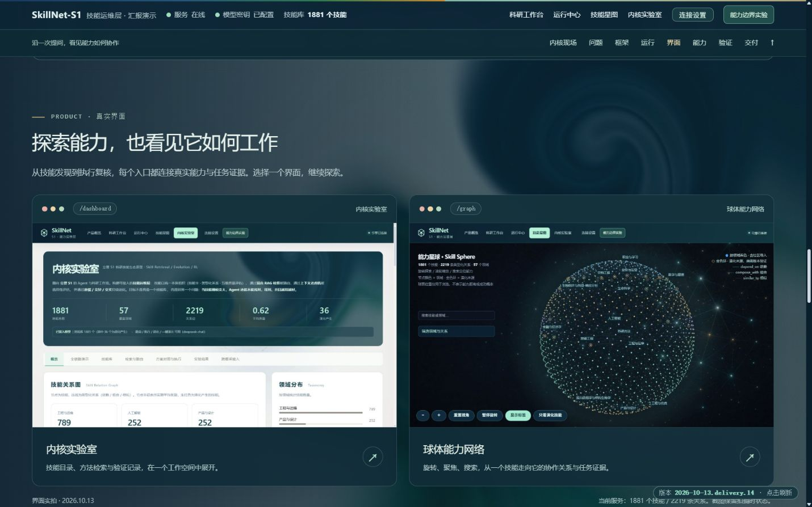
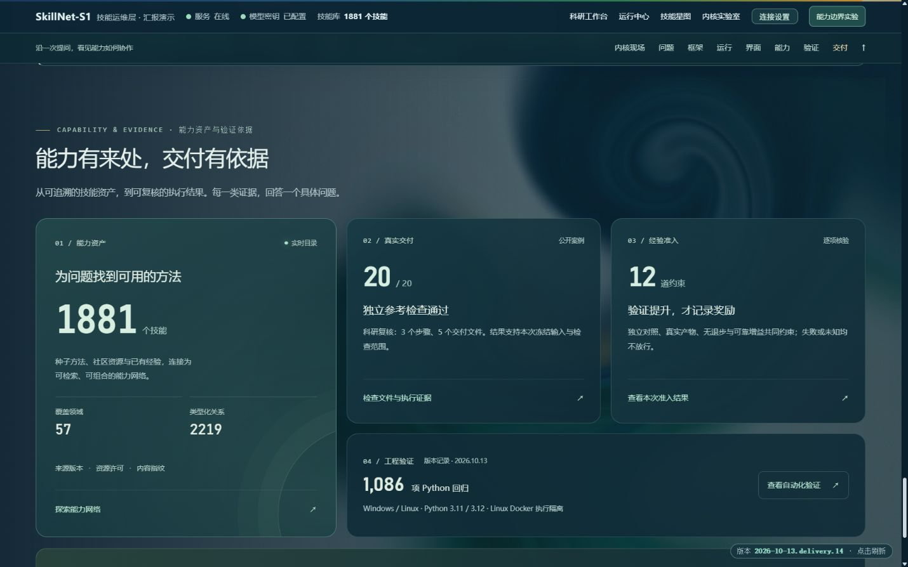
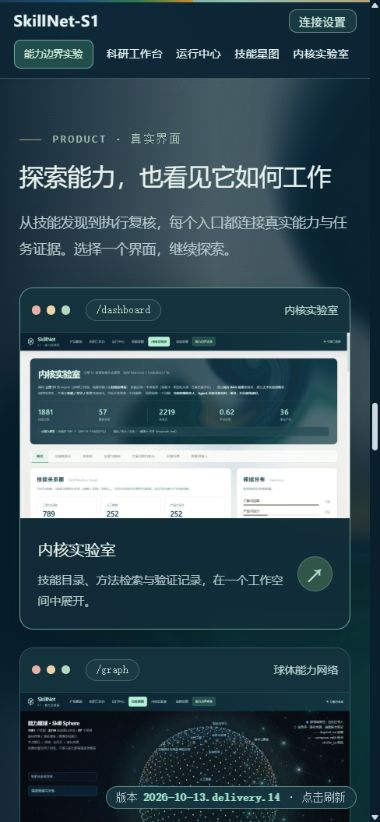
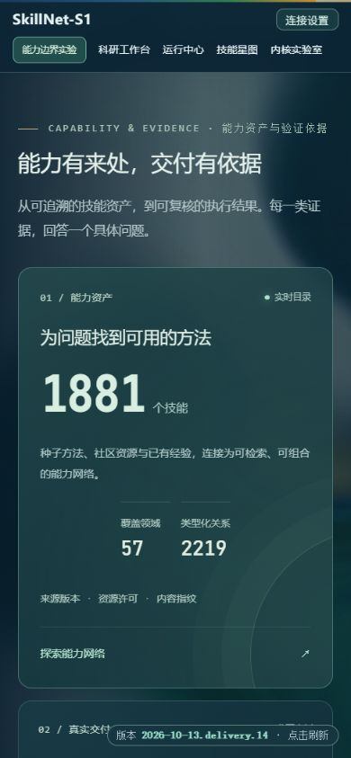

# 产品总览界面更新与核验

日期：2026-10-13。页面版本：`2026-10-13.delivery.14`。

## 更新范围

- 首页界面预览替换为当前内核实验室与球体能力网络的实机截图，保持对应页面入口；截图与实时规模分别标记。
- 交付依据重排为能力资产主卡、真实交付、十二门准入与工程验证，统一深色材质、边框、留白及链接层级，移除旧计数容器和密集扩容说明。
- S1 接入说明独立呈现，明确服务契约已具备、生产联调待验证。
- 产品说明按定位、价值、能力、应用场景及验证进展编写；启动、配置与操作集中到技术文档。原有球体探索、连续背景和七阶段执行交互保留。

## 实际观察

使用浏览器实机观察首页两个修改区域，未新增模型任务或付费调用。

| 视口 | 观察结果 |
|---|---|
| 1440 × 900 | 双列预览；能力资产主卡、右侧证据卡和工程验证条层级清楚；无旧白色网格缝隙 |
| 768 × 1024 | 能力资产横跨两列，交付与准入并排，工程验证横跨两列；无水平溢出 |
| 390 × 844 | 预览与证据卡单列；底部接入、资料链接和页脚可读；无水平溢出 |
| 320 × 740 | 卡片与文本保持在视口内；七个证据区域链接高度均至少 44 CSS px |

键盘 Tab 从能力网络入口移至执行证据链接，观察到可见金色焦点框。桌面及手机页已采集的浏览器 error 日志为空。预览图片均加载成功；预览对应 `/dashboard`、`/graph`，公开证据对应固定科研 Run，接入说明对应 `/docs`。

本次是两个修改区域的观察，不代表全站辅助技术认证。实体触屏、屏幕阅读器、200% 缩放、所有页面和 S1 生产联调仍需专项验收。自动回归结果以对应提交的 GitHub Actions 为准。

## 实机截图

截图保留当时的运行资产规模，不能替代新部署的实时读数。

更多历史观察见 [前端审计记录](review.md)。
