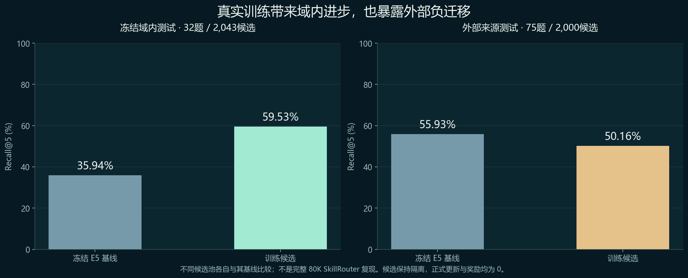

# 技能网络训练与个人能力生态：首轮研究及本地实现

研究日期：2026-10-14。首轮先在本地完成；按用户后续授权，随 `2026.10.14-complete.19` 交付实现、数值候选、检查点与研究证据。个人历史与原始上游数据不重新分发。

本轮真正完成了模型训练和个人网络实现。结论是：**技能选择可以从固定规则走向可训练表示；但一次域内进步不足以授权通用网络更新。** 本次候选在冻结的 SkillNet-Gym 路由测试中提高召回，在另一来源上出现负迁移，研究门禁将其拦截。用户个人偏好以独立的小模型和配置保存，不覆写共享权重。

这不是已经完成通用能力自进化的证明，也没有将“图神经网络”作为默认更好的答案。图消息版本在本次消融中弱于文本适配版本，最终候选由验证集选出，使用文本适配结构。

## 研究定位与竞争对比

技能路由训练、技能演化和小型适配器均已有研究基础。因此，本项目不能仅以“训练了 Skill 网络”宣称独创。值得继续发展的产品价值是：将可训练的方法选择、用户可控制的个人能力资产，以及拒绝负迁移的证据机制接入 S1 的科研流程。

| 已核验的工作 | 已有能力 | 对本项目的直接启发与差异 |
| --- | --- | --- |
| [SkillNet](https://github.com/zjunlp/SkillNet)、[论文](https://arxiv.org/abs/2603.04448) | 技能发现、评估、关系分析、路由 | 复用其技能资产思想；本轮增加真实参数训练、私有适配及实验拒绝路径。官方 SDK 的文档评估不能代替实际执行验收。 |
| [SkillNet-Gym](https://github.com/zjunlp/SkillNet-Gym) | 带文件、参考技能与验证器的组合任务 | 使用其官方任务包的文本和附带技能作为训练/评估来源；本轮没有执行全部上游任务及其外部依赖。 |
| [SkillRouter](https://github.com/zhengyanzhao1997/SkillRouter)、[论文](https://arxiv.org/abs/2603.22455) | 面向大型技能池的可训练检索与重排，重视技能正文 | 说明“训练路由”已有直接竞争工作；本轮采用冻结编码器与小适配器，评估口径不同，不能将本项目数字与其论文成绩直接比较。 |
| [SkillOpt](https://github.com/microsoft/SkillOpt)、[作者说明](https://www.microsoft.com/en-us/research/blog/skillopt-agent-skills-as-trainable-parameters/) | 在冻结模型外优化自然语言技能，并用验证控制更新 | 本轮训练数值参数，并将技能正文、偏好设置、训练候选与能力奖励分开保存。 |
| [ASSAY](https://arxiv.org/abs/2606.15390) | 用随机屏蔽测量技能贡献，关注不同任务上的正负作用 | 不把使用频率或单次成功当成统一奖励。当前路由实验尚未证明执行时的因果贡献。 |
| [SEA](https://arxiv.org/abs/2607.00871) | 冻结底座、小范围自修改与 anytime-valid 证书 | 本项目采用冻结底座、版本化证据和拒绝更新；现有十二门不是 SEA 的形式化统计保证，不能等同。 |
| [The Router Within](https://arxiv.org/abs/2609.15982) | 从冻结模型内部信号读取路由能力，以少量参数适配 | 小模型不是天然劣势，但必须通过跨数据来源的真实对照验证。 |
| [AutoSkill](https://arxiv.org/abs/2603.01145)、[ContinualSkillBench](https://arxiv.org/abs/2608.03874) | 从经验形成技能，以及持续演化评测 | 后续重点应是长期使用过程、遗忘与负迁移，而不是只展示一次训练损失下降。 |
| [Skill Self-Play](https://github.com/Qwen-Applications/skill-self-play) | 技能引导的任务生成、验证和学习边界课程 | 未来扩展验证任务时应保留独立测试来源，不能让生成、评估和准入共用同一份自我判断。 |

这些对比支持方向选择，不能证明“全网不存在相似系统”或已经具备市场领先地位。

## 实际训练了什么

底座是固定版本的 multilingual-e5-small 文本编码器。新的网络学习问题表示与技能表示之间的匹配，以及声明关系的邻居消息组合。它负责选方法，不替代执行任务的语言模型。

- 文本维度 384；低秩维度 48；总计 **110,596 个可训练参数**。
- 先以技能摘要与正文多视图进行 8 轮对比预训练，再用官方任务的训练分区进行最多 40 轮多正例路由微调。
- 正文使用前、中、后三个切片编码，保留比单纯名称/摘要更多的实现信息；仍不等于理解了全部脚本及依赖。
- 关系类型包括 `depend_on`、`compose_with`、`similar_to` 和训练分区的 `co_use`。`co_use` 来自同任务附带技能的共现，不能解释为因果关系或已验证的先后依赖。
- 分别训练文本适配与图消息适配，随机种子为 17、29；共四组。检查点只按验证集 Recall@5 选择，平分时保留更早的轮次。
- GPU 训练使用本机 RTX 4050、PyTorch 2.7.1+cu118；部署预览使用 NumPy 读取数据型 NPZ 权重，不要求在线推理安装 PyTorch。

本地候选模型为 `network-b9e7622390ddc716`，权重 SHA-256：

`b9e7622390ddc71633586f71bce15960940801808693eea2189d2835c267f3f5`

真实预训练权重、微调权重和逐轮损失均保存在本地实验目录。模型分数表示学习到的相关度，**不是执行成功概率，也不是技能的因果质量分**。

## 数据、划分与复查

SkillNet 代码版本 `ec1488b37ba4bd5b0820b1b1e2dee2f3a4d9b092`；SkillNet-Gym 代码版本 `54d0081041bf341496b76c50475342d69af306d5`。官方链接指向约 8.78 GB 的 ZIP。本轮使用公开 HTTP 字节区间读取 ZIP 目录，提取 894 个必要文本文件，合计约 4.86 MB；逐项验证 ZIP CRC32 与 SHA-256，没有运行上游脚本。

语料包含 159 道官方任务、1,881 个当前产品技能和 162 个新增的 Gym 正文节点，共 **2,043 个去重节点**。关系有 2,957 条记录，去重后 2,539 条用于消息混合。任务附带技能作为“参考包检索目标”，不假定它们一定是最少必要集合。

训练/验证/测试为 **106 / 21 / 32**。划分在编码与训练前冻结，同一参考技能名称集合归入同一分区；复查确认分区之间没有相同问题或相同参考包族，训练与测试之间没有相同规范化 gold 集合，也未发现词集合 Jaccard 大于 0.65 的题目对。以上检查不证明语义完全独立。

公开技能正文参与传导式预训练，测试问题和任务标签不进入梯度、不用于选择检查点。首次实验协议 SHA-256：

`5706178b4d193b05d629089cf3226cdb103332a53e880f8183037a9d797821d3`

原始协议没有绑定十二门政策指纹，这是本轮自检发现的真实缺口，不能事后补写成“已冻结”。后续数据准备代码已补上政策冻结，但首轮历史证据原样保留。

## 正面结果与负面结果



| 条件 | 冻结 E5 基线 Recall@5 | 验证集选出的候选 | 变化 |
| --- | ---: | ---: | ---: |
| Gym 测试 32 题，2,043 候选 | 35.94% | 59.53% | +23.59 个百分点 |
| 外部来源 75 题，2,000 候选 | 55.93% | 50.16% | −5.77 个百分点 |

域内 18 题进步、3 题退步、11 题持平。按参考包族聚合有 14 个统计单位，8 个进步、2 个退步；描述性的单侧符号检验 p=0.0546875。逐题计算得到的更小 p 值不能代替任务族层面的分析；这也不是预注册的 anytime-valid 证书。

外部测试使用 [SkillRouter-Eval-Core](https://huggingface.co/datasets/pipizhao/SkillRouter-Eval-Core) 的固定版本 `20a03920e7f08d76b67af367350d25ef4468198e`。候选池为 196 个参考技能、780 个已发布干扰变体和 1,024 个按技能 ID 哈希选出的普通干扰项。75 道题与全部 Gym 题目没有精确重叠；模型没有根据外部结果重新训练。外部结果为 7 题进步、20 题退步、48 题持平。

**这不是完整 79,141 候选的 SkillRouter Hard 复现。** 发布包中的部分 graded `degraded/*` 标识没有对应池条目，本轮没有虚构补齐这些条目，也不报告受其影响的 nDCG。

四组域内消融：

| 版本 | 验证 Recall@5 | 测试 Recall@5 | 选择轮次 |
| --- | ---: | ---: | ---: |
| 文本适配 / 17 | 52.38% | 54.38% | 微调 5 |
| 文本适配 / 29 | 53.97% | 59.53% | 微调 7 |
| 图消息 / 17 | 50.48% | 54.06% | 预训练后 |
| 图消息 / 29 | 48.10% | 49.38% | 预训练后 |

图消息在微调中出现明显过拟合。本轮不把图结构装饰或训练损失下降当作算法有效性的证明。

## 与十二门的联系

独立检查程序重新读取真实权重、特征、协议和 gold，完整复算两次确定性排序。两次复算用于检查可复现性，不把独立样本数加倍。当前路由模型研究审计为 **7/12，通过条件不足**。

被拦截的门包括：奖励政策冻结指纹缺失、任务退步、外部增益不足、可靠性证据不足、尚无版本准入凭证。正式共享排序没有替换，提升奖励为 0。路由研究的检查通过不能替代下游产物、任务成本、安全约束及技能因果贡献的验证。

用户可以手动选择个人偏好版本，作用与置顶、停用等个人意图设置相同：只影响 `/personal` 的个人检索，不宣称能力改善，不发能力奖励，可随时撤回。**这不是自动准入绕过十二门。** 共享底座的自动晋级仍被拦住。

## 已落地的个人网络

个人空间由可信 S1 签名中的租户、用户、项目确定。浏览器提交任意用户 ID 不会切换拥有者。没有签名配置时，个人接口只允许回环访问，使用单机个人空间。

当前实现包括：

- 可旋转、缩放、选择、过滤的真实技能球体；个人置顶、停用和私有方法叠加展示，球面位置仍是浏览布局。
- 私有技能的适用说明与步骤编辑；用户关系定义；未知节点、重复边和依赖环被拒绝。
- 配置版本、并发编辑冲突、历史回滚、导出与经验收集开关。暂停记录后保留个人设置。
- 提问和终态运行进入未标注经验池；点击、使用频率、参与执行和单次模型评分不被转换为正向奖励。
- 只有明确的 A 优于 B 偏好进入个人偏好训练。未选择的其他技能不被统一设为负例。
- 个人适配器进行真实梯度更新，保存协议、损失曲线、权重及指纹；训练与留出按问题哈希分离。
- 私有方法与共享候选采用同一个人适配表示重排；参考偏好的共享正文发生变化时，旧候选拒绝使用。训练从保留的经验中选最近 200 组明确偏好，无标签提问不会挤掉仍保留的偏好样本。
- 个人候选可对照、由本人手动用于本页检索、撤回原策略。配置改变会自动停用旧候选，其他用户及共享模型不受影响。

当前个人适配基于原冻结 E5 编码器，尚未叠加在未准入的通用训练候选上。通用候选的训练验证与个人偏好的可控学习已经接通实验与产品接口，但“新通用底座自动上线，再持续更新个人能力”的完整自动晋级尚未通过证据验收。

受控实验使用两个虚拟用户和 16 条合成偏好问题，各 9 个训练问题、7 个留出问题。同一道题上，一个偏好 Python 方法，一个偏好 Excel 方法，训练后候选给出相反排序。Excel 偏好组的留出偏好匹配由 0/7 变为 7/7；两个空间数据隔离，共享技能库和共享权重指纹不变，奖励仍为 0。

最终代码在新的 `personal-controlled-v2` 目录复跑同一组受控实验，结果复现，并核验手动选择、读取该版本及撤回。这是确定性复跑，不增加独立用户或样本量。

**这是工程可行性实验，不是真实用户研究，也不是任务成功率证据。** 当前生产工作台的自动执行保持原共享策略；个人私有正文可以检索和编辑，本轮不自动执行未审核私有代码。

## 验证、复现与本地入口

本轮验证：1,132 项 Python 测试（含 27 项个人网络专项）、31 项产品自检、已有前端检查与新个人页面 DOM 交互检查通过。DOM 检查还覆盖画布不可用时的列表降级。实际回环 HTTP 完成当前/候选检索对照，技能版本核对无过期项，记录未标注问题，没有改变共享权重或奖励。

浏览器预览工具启动时持续出现 `failed to write kernel assets (os error 3)`。因此，本轮完成了 DOM、资源、API 与交互逻辑核验，**尚未完成真实浏览器截图、像素布局和人工交互的视觉验收**。没有用代码成功冒充视觉验收。

产品入口为 `/personal`，默认本地地址 `http://127.0.0.1:8848/personal`；独立研究服务为 `http://127.0.0.1:8858/personal`。候选权重与目录特征在 `data/network-model/`，四组检查点及冻结证据在 `assets/network-research/v1/`，均随交付清单校验；个人运行数据位于配置的 OUT_DIR 下 `personal-network/`，不进入 Git。实验服务另用独立 runtime-data 与 runtime-out。

可移植复现流程（每次使用新实验目录，不覆盖已冻结测试）：

```powershell
python -m pip install -r requirements-training.txt
python tools/fetch_gym_index.py --output data/training-sources
python tools/fetch_gym_metadata.py --output data/training-sources
python tools/prepare_network_training.py --gym-dir data/training-sources/datasets/gym --output data/network-experiment-new
python tools/train_network.py --experiment data/network-experiment-new
python tools/fetch_skillrouter_probe.py --output data/training-sources
python tools/evaluate_network_transfer.py --external data/training-sources/external-test --model data/network-experiment-new/product-bundle
python tools/audit_network_training.py --experiment data/network-experiment-new --external data/training-sources/external-test
```

上述结果只适用于本轮固定数据和模型。官方仓库的代码许可不能自动为所有上游技能、数据和模型派生物重新授权；本轮数据保留在本地研究目录，未随报告重新分发原始包。商业发布前仍需逐源确认许可与使用范围。

## 下一轮值得验证的假设

1. 用新来源的独立封存题验证带保守约束的领域适配器，比较域内收益与外部负迁移，而不是继续调已经看过的测试集。
2. 收集真实用户的明确偏好及受控执行对照，测量个人使用收益、跨用户隔离、撤回成本和长期遗忘。
3. 将真实前后状态、失败边界和可执行契约作为图关系的监督来源；在独立组合任务上证明其价值，再考虑更复杂的图模型、能力基和边界主动探索。
4. 在新的预注册协议中冻结模型、奖励政策、指标与统计单位；从固定样本检验逐步研究有效的连续检验，不能直接套用论文名词作为证书。

“可训练路由 + 私有适配 + 可验证准入”已具有可运行基础；通用网络自动晋级和领先性仍需要下一轮证据。
