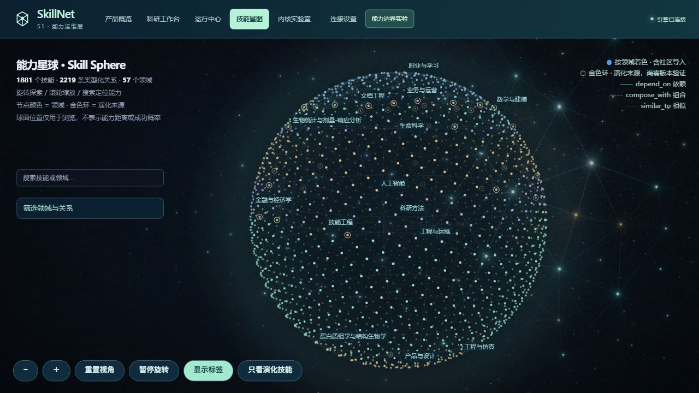
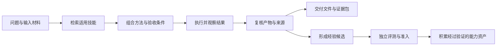

# SkillNet / S1 科研能力生态

## 产品说明

**让一次提问留下可交付、可复核、可积累的资产。**

版本日期：2026-10-13。

SkillNet 将科研方法、执行工具和实践经验组织为可检索、可组合的技能网络。用户提出问题后，系统选择适用的技能，组织任务执行，形成数据、图表、报告与来源证据，并对结果进行复核。

产品面向 S1 的科研业务场景，提供从方法发现到成果交付的能力支撑。其核心价值在于：让科研任务使用的方法可解释、执行过程可追踪、交付结果可检查，经过验证的经验能够作为后续任务的能力资产。

## 一、产品定位与业务价值

科研任务往往跨越资料检索、数据处理、统计分析、图表生成和结果解释。不同环节需要不同方法，也需要明确的输入、适用条件和验收标准。SkillNet 以 Skill 为能力单元，将这些方法连接起来，支持按任务选取与组合。

| 业务需求 | 产品能力 | 对用户的价值 |
|---|---|---|
| 找到适合当前问题的方法 | 技能自检索、关系扩展与任务路由 | 减少重复寻找方法的工作，明确方法选择依据 |
| 了解系统如何得到结果 | 阶段进度、执行依赖、代码与文件追踪 | 能检查方法、输入及中间过程 |
| 获取可继续使用的成果 | 数据、图表、报告与来源证据包 | 将问答结果转化为可下载、可复核的交付物 |
| 判断结果是否可靠 | 输入条件检查、产物验收与独立复算 | 区分已验证结果与仍缺证据的结论 |
| 复用已有科研经验 | 技能资产、历史任务、文件版本和候选治理 | 为后续同类任务保留方法与证据 |

## 二、核心能力

### 1. 技能自检索与任务组合

系统根据问题寻找少量适用的 Skill，综合文本相关性、技能关系与任务需求进行选择，支持 BM25、混合检索及模型路由。技能不足时可以保留空选，避免为完成流程而强行采用无关方法。

用户可以查看推荐技能、采用理由及实际参与的执行步骤。相关度用于辅助选择，最终效果仍由任务产物和验收证据判断。

### 2. 球体能力网络

技能以可旋转的球体网络呈现，支持领域聚焦、节点搜索、有方向的关系探索和返回导航。每个技能关联适用条件、输入输出、操作方法及失败边界；任务中的执行步骤进一步连接实际文件与检查结果。

这种呈现方式将能力规模、方法关系和任务过程放在同一个可探索的空间中，便于理解系统具备哪些能力，以及这些能力如何协作。

图 1：球体能力网络，支持搜索、领域筛选、旋转及关系探索。界面截图保留拍摄时的运行状态，技能数量随运行资产变化。

### 3. 可观察的任务执行

任务以七阶段过程和执行依赖图呈现。系统在执行前检查输入及前置条件，在执行后核验实际效果，记录代码、输出、错误、修复、时间和费用。后续步骤使用已登记的真实文件版本，避免文件来源和依赖关系不清。

用户能够从结果追溯到采用的方法、执行步骤和输入材料；历史任务支持按阶段回放与检查。

### 4. 真实联网研究与来源核验

系统支持公开网络搜索和学术元数据检索，将来源地址、访问状态、采集时间、正文摘录和快照指纹纳入任务证据。原站内容与第三方提取内容分别标记，来源不可访问或证据不足时保留未知状态。

人物调研先核对身份信息，再进入著作分析；同名、机构或领域仍存在歧义时，后续分析受到限制。引用核验能够检查摘录与来源是否对应，结论本身仍需结合来源质量及任务标准判断。

本地方法供给不足时，系统还可发现公开 GitHub 技能，核对许可和固定版本，作为当前任务的隔离方法参考。

### 5. 成果交付与经验复用

任务可以交付数据表、图表、报告及证据包，支持预览、下载、内容指纹和步骤版本检查。明确追问能够复用已有文件，新话题与历史任务保持独立。

交付版包含 **1,881 个 Skill**，其中 76 个种子技能、1,769 个独立社区技能及 36 个已有演化技能；社区资源包包含 **10,898 个文件**。技能正文、来源版本、许可证和内容指纹可追溯。资产入库与具体任务的执行验证分别管理。

### 6. 受约束的技能改进

模型评分作为参考，产物检查和独立评测提供主要证据。系统将执行经验先纳入隔离候选，通过冻结规则、留出对照、无退步与可靠增益等十二道准入门后，才对被验证版本记录有上限的奖励。

该机制避免将一次任务成功归功于全部参与技能，也避免未经验证的经验直接改变正式网络。失败、未知和拒绝原因均保留，便于复查与修订。

图 2：能力资产、交付检查与经验准入的产品总览。界面区分实时目录与历史验证记录，各项证据可进入对应页面复核。

## 三、任务如何转化为能力资产

这条主线将技能发现、真实执行和经验治理连接起来。技能的价值由其在具体条件下能否产生合格交付来检验，网络中的连接则帮助系统选择和组织方法。

## 四、典型应用场景

| 场景 | 任务内容 | 主要交付 |
|---|---|---|
| 科研数据质量复核 | 检查重复样本、跨分组泄漏、缺失值及指标口径 | 清洗数据、审计表、复算指标、图表与报告 |
| 学术资料与人物研究 | 搜索公开资料、核对身份、整理著作及出处 | 身份台账、来源记录、证据摘录与研究缺口 |
| 经营数据分析 | 处理数据、计算指标、生成可视化并继续追问 | 数据表、图表、分析报告及文件版本 |
| 方法发现与复用 | 为新问题寻找技能组合，读取方法和支持资源 | 技能契约、适用条件、资源包与执行记录 |

科研数据质量复核的公开固定输入运行已完成 3 个步骤、形成 5 个交付文件，并通过 20 项独立参考检查。公开联网任务已完成来源采集、台账生成与正文对应核验；未解决的身份歧义仍保留为未知。

这些案例验证了相应输入与检查标准下的产品链路，后续业务效果需结合实际任务持续评估。

## 五、研究内核与验证进展

产品围绕“技能在什么条件下有效、产生什么效果、如何发现失败边界”开展研究，并已接入以下机制：

| 研究方向 | 已实现的能力 | 当前验证范围 |
|---|---|---|
| 条件与效果契约 | 执行前核验条件，执行后检查实际状态变化 | 已接入任务执行与产物检查 |
| 能力边界识别 | 区分缺条件、缺提供者与证据不足，执行后重新观测 | 有限状态模型及固定公开情景 |
| 可证伪的方法评价 | 独立复算、反例探针与缺陷版本拒绝 | 预定义假设与冻结输入 |
| 有限能力基 | 检验哪些登记程序组合能够覆盖目标任务 | 5 个登记程序、32 个子集及 8 个开发任务 |
| 版本准入与奖励 | 多条件共同约束改进判定，保留证据与唯一凭证 | 十二道准入门，未满足条件不奖励 |

能力边界实验在 23 个冻结合成任务上完成了 391 次真实 Python 调用。在其中 16 个有效任务上，定向执行并重新观测的方法通过 16 个，直接执行和仅声明规划各通过 2 个；三组对 7 个负例均未误接受。定向方法使用了更多实际调用。

结果支持这一任务族中的完成覆盖改善；通用因果转移模型、开放领域行为等价和全库最小能力基仍属于后续研究方向。

## 六、与 S1 的协同方式

SkillNet 可作为 S1 的独立能力服务，分阶段接入现有产品体系。

**技能服务接入。** S1 根据用户问题检索方法，按需加载技能正文和资源，继续使用既有 Agent、模型与执行流程。

**科研任务接入。** S1 发起具有预算约束的任务，将阶段进度、成果附件、来源证据与验收结果呈现在现有工作空间。

**能力资产积累。** 将通过验证的方法、任务记录和证据纳入能力管理，为后续同类任务提供可追溯的复用基础。

现有 HTTP 接口、Python 客户端、身份签名、事件流、产物下载及证据包已实现并接受测试。S1 线上身份、项目权限、附件系统与生产网络仍需在实际环境中联调验收。

## 七、当前进展与后续重点

当前版本已具备技能发现、球体探索、真实执行、联网核验、产物交付、历史追踪与候选准入的完整链路。自动验证覆盖 Windows / Linux、Python 3.11 / 3.12，以及 Linux 执行容器隔离；研究结论与产品功能分别保留验证依据。

下一阶段重点是完成 S1 实际接入，在真实科研任务中扩展评测覆盖，完善生产部署、权限与附件管理，并持续检验方法复用是否带来可测量的业务收益。

**条件收益与失败边界。** 新增执行收益实验，按输入条件比较技能的正负作用，先保存预测，再运行程序并独立复核文件。两轮封存验证保留了未带来额外收益的模型对照，也验证了分组边界修正对减少无效执行的作用。质量提升、失败避免与范围规则分别计量，研究候选仍需完整准入，尚未替换正式路由。方法与限制见 [条件收益研究](conditional-utility-research.md)。

技术配置、接口与详细验证资料见 [技术部署与操作说明](technical-operations.md)、[S1 接入契约](s1-integration.md) 和 [能力边界研究结果](frontier-results.md)。
