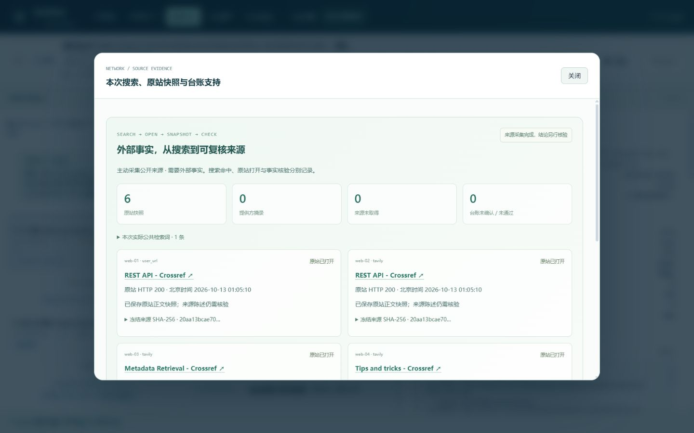

# SkillNet · 技术部署与操作说明

更新日期：2026-10-13。本文供开发、部署及接入维护人员使用，涵盖运行环境、配置、接口和验证范围。产品定位、业务价值和能力介绍见 [产品说明](product-guide.md)。

## 1. 页面与服务入口

完整交付版为 `2026.10.13-complete.18`，初始技能库与本机交付快照一致，共 1,881 个技能。全新克隆后先执行 `python tools/verify_delivery.py --strict-runtime`；启动时显示项目目录、交付版本和 Git 提交，`/api/health` 的 `distribution` 提供同一进程的版本信息。正式 PDF 见 [产品说明 PDF](SkillNet-S1-产品说明.pdf)，完整范围见 [交付一致性说明](delivery-parity.md)。

| 页面 | 路径 | 主要内容 |
|---|---|---|
| 产品总览 | `/` | 整体价值、能力球体、内核现场与七阶段 |
| 对话工作台 | `/chat` | 真实提问、预算、联网模式和追问 |
| 技能网络 | `/graph` | 球体探索、技能检索、关系及详情 |
| 运行中心 | `/runs` | 历史任务、执行与验收状态 |
| 运行详情 | `/run?id=<run_id>` | 回放、代码、文件、来源与独立检查 |
| 内核实验室 | `/dashboard` | 七个功能视图及研究证据 |
| API 文档 | `/docs` | HTTP 接口与请求结构 |
| S1 能力清单 | `/api/integrations/s1` | 接入契约与当前验证状态 |

仓库附带公开科研和经营任务的历史记录。回放读取持久化事件，不新增模型调用；可以查看任务阶段、代码、文件和验收结果。固定能力边界实验不需要模型密钥。新建模型任务需完成下文配置。

仓库包含公开模拟任务与 Crossref 来源核验的完整回放记录及登记产物；私有任务记录继续保留在本机。首页预览已同步当前内核实验室与球体网络，交付依据采用独立证据卡片；本次页面范围和断点观察见 [界面核验记录](frontend-audit/delivery-ui-review.md)。

## 2. 拉取 main 与本机启动


需要 Git、Python 3.11+。前端是原生 HTML / CSS / JavaScript，启动服务不需要 npm 构建；建议在新目录使用虚拟环境。

Windows PowerShell：

```powershell
git clone --branch main https://github.com/qing1989620/skillnet-demo.git
cd skillnet-demo
python -m venv .venv
.\.venv\Scripts\python.exe -m pip install -r requirements.txt
Copy-Item .env.example .env
.\.venv\Scripts\python.exe run.py --no-browser
```

macOS / Linux：

```bash
git clone --branch main https://github.com/qing1989620/skillnet-demo.git
cd skillnet-demo
python3 -m venv .venv
.venv/bin/python -m pip install -r requirements.txt
cp .env.example .env
.venv/bin/python run.py --no-browser
```

打开 `http://127.0.0.1:8848`；健康接口为 `http://127.0.0.1:8848/api/health`。Windows 也提供 `start.bat`，macOS / Linux 提供 `start.sh`。

已有**干净工作区**更新：

```bash
git switch main
git pull --ff-only origin main
```

运行数据和 `.env` 继续保留在本机。若有未提交修改或分支分叉，先处理本地改动，不要强制重置覆盖数据。

### 模型、搜索与运行配置

编辑 `.env`，值不加引号，保存后重启服务；操作系统中已设置的同名环境变量优先。

| 变量 | 用途 | 默认 / 配置建议 |
|---|---|---|
| `DEEPSEEK_API_KEY` | Fabric 重排、编排及真实模型任务 | 本机填写自己的密钥；留空可浏览、基础检索与回放 |
| `DEEPSEEK_BASE_URL` | 模型服务地址 | `https://api.deepseek.com` |
| `DEEPSEEK_MODEL` | 模型名称 | `deepseek-chat` |
| `SKILLNET_WEB_ENABLED` | 宿主公开来源采集开关 | `true`；`false` 全局禁用 |
| `TAVILY_API_KEY` | 通用搜索账户 | 可留空试用官方匿名模式；生产配置组织账户 |
| `SKILLNET_TOKEN` | 服务访问令牌 | 监听非本机地址时必填 |
| `SKILLNET_MAX_ACTIVE_RUNS` | 同时运行任务上限 | 默认 `4`，合法范围 `1–32` |

BM25 / Hybrid 不调用付费模型；Fabric 需要模型配置。完整安装携带约 85 MB 的固定多语言语义模型包，首次启动自动解压并逐文件核验，不再依赖另一个模型下载站。默认健康状态应为 `encoder.kind=dense-onnx`。需要手动恢复时，在同一虚拟环境执行：

Windows PowerShell：

```powershell
.\.venv\Scripts\python.exe -m pip install -r requirements-semantic.txt
.\.venv\Scripts\python.exe tools/setup_semantic_model.py
```

macOS / Linux：

```bash
.venv/bin/python -m pip install -r requirements-semantic.txt
.venv/bin/python tools/setup_semantic_model.py
```

公开模型包随仓库与交付 ZIP 分发，许可、来源和 SHA 见 [模型资产说明](../assets/semantic/README.md)。本机展开缓存可再生成；`.env`、服务令牌及公司数据由部署环境管理。

## 3. 联网与事实核验

通用搜索使用 Tavily，学术元数据补充 Crossref / Europe PMC。原站抓取核验公共地址、TLS 和每次重定向，限制时长与字节；来源索引和快照绑定到本次 Run。第三方正文提取会明确标记，原站 HTTP 未知仍显示未知。匿名搜索的额度和可用性不作保证。

工作台支持 `auto / on / off`。明确禁网、机密资料和全局禁用优先于 `on`。公开方法补充使用固定能力词，不发送原始问题中的姓名、数据行或路径；但预处理无法识别所有自然语言秘密，敏感业务应选择 `off` 或部署组织自己的搜索服务。

来源复核重新检查快照与 SHA、URL / 来源 ID、CSV 结构及正文连续摘录。**摘录匹配证明出处对应，不等于结论必然成立或来源本身可信。** 人物调研还必须先通过身份台账门，机构、领域等支持不足时，停止后续著作聚类并保留未知。

在线发现的技能只作为本次运行的隔离方法参考，不自动安装、执行远程脚本或写入正式库；发现成功本身不奖励。详见 [联网研究与在线技能补充](web-research.md)。



图：本轮公开任务的本机来源面板，展示原站记录、快照和核验信息；这是历史实机截图。

## 4. S1 接入与部署边界

建议分两步落地：

1. **技能生态接入。** S1 后端注册 `search_skills` 与 `load_skill`，先读取摘要，再按需加载正文和资源；继续使用 S1 现有 Agent 和模型执行流程。
2. **科研运行接入。** S1 后端显式创建有预算的 Run，将阶段事件、产物、来源和证据包呈现在 S1。由 S1 管理用户、项目和会话权限映射。

SkillNet 已提供 Python 客户端、HTTP 工具处理器、事件订阅、取消、下载完整性校验和能力报告。服务令牌保留在后端；签名身份涵盖租户、用户、项目、请求内容和时效，并持久化拒绝重复写请求。接入状态明确保留 `production_connection_verified: false`，等待 S1 真实环境验收。

本机默认使用单 API 进程和宿主子进程，适合受控演示。公司部署建议启用独立 worker 与 Docker 执行模式：

- `SKILLNET_WORKER_MODE=external`：单主机 SQLite 持久化队列，一个技能库写入 worker；API 与 worker 共享 `data / out`。
- `SKILLNET_SANDBOX=docker`：先构建 `deploy/Dockerfile.executor` 对应镜像，分析容器禁止联网、限制资源；Docker 不可用时拒绝降级。
- 监听非本机地址时设置 `SKILLNET_TOKEN`；公网访问使用 HTTPS 与公司的访问控制。S1 签名密钥至少 32 字符，仅由可信后端管理。
- 备份运行库、`out` 与密钥配置，按公司要求控制保留期限和附件访问。当前不支持跨主机队列与多写入 worker 扩容。

Linux Docker 执行隔离已通过 CI 实机验证；Windows Docker、S1 SSO、附件存储和生产网络仍需在目标环境验收。宿主子进程的文件与超时约束不等于操作系统安全隔离。配置、SDK 示例和双进程启动命令见 [S1 接入契约](s1-integration.md)。

## 5. 验证证据与当前范围

| 证据 | 已核验结果 | 结论范围 |
|---|---|---|
| 自动回归 | 2026-10-13 交付基线：1,086 项 Python 测试、31 项离线自检、12 组 Node 检查通过 | 离线逻辑、接口、约束和前端资源行为；各提交结果以 GitHub Actions 为准 |
| 跨平台 CI | Ubuntu / Windows × Python 3.11 / 3.12，另含 Linux Docker smoke | 自动回归和执行容器检查，不调用付费模型 |
| 科研真实运行 | 3 步、5 文件、20/20 独立参考检查；11 次模型调用、¥0.2048 | 这一输入及冻结判据；正式奖励 0 |
| 公开联网运行 | 2/2 步、6 条 HTTP 200 记录、31 条台账检查；10 次调用、¥0.1766 | 同一域、5 个实体指纹；行检查不等于独立科学事实数量 |
| 能力边界实验 | 23 个合成任务，完整矩阵实际启动 391 次 Python；有效任务 16/16 对比 2/16 | 同一冻结任务族；定向组调用更多，不能解释为通用增益或省成本 |
| 有限能力基 | 穷举 32 个登记子集，8 个冻结开发任务的最小覆盖子集为 4 个程序 | 当前控制器、环境、目标集合与 5 个登记程序 |
| 前端实机观察 | 指定桌面与手机断点、来源面板、SHA 预览、Escape 与焦点恢复 | 不替代全视图、屏幕阅读器、200% 缩放及实体触屏验收 |

这些金额、成功率和耗时都是历史实测，不是新任务的价格或质量承诺。失败轮次与未知状态也保留；研究实验不自动改写正式技能、排序或奖励。

交付后的下一步重点是 S1 实际联调、更多真实科研任务族的独立评测，以及生产部署与完整辅助技术验收。

## 6. 文档导航与常见问题

| 文档 | 用途 |
|---|---|
| [仓库 README](../README.md) | 启动、代码位置与验证命令 |
| [S1 接入契约](s1-integration.md) | SDK、身份、预算、事件、产物与 worker |
| [真实联网研究](web-research.md) | 搜索、证据台账、在线方法补充及隐私边界 |
| [十二门奖励准入](reward-gates.md) | 版本奖励条件、冻结规则和证据 |
| [能力边界研究结果](frontier-results.md) | 原始实验、失败记录、复现命令与结论范围 |
| [球体与全页交互](exploration-interactions.md) | 领域、关系、步骤证据及跨页上下文 |
| [前端审计记录](frontend-audit/review.md) | 分日期审计与待完成验收项 |

**没填 API Key 可以看什么？** 首页、球体、技能详情、BM25 / Hybrid、冻结实验、公开历史回放和标准技能目录导出。新建完整模型任务与 Fabric 重排需要密钥。

**为什么任务显示完成，验收仍有未知？** 完成表示执行结束；验收只覆盖确实检查过的范围。缺参考数据、身份不明或来源不足时应保留未知。

**为什么问完一次问题，网络没自动涨分？** 单次成功不足以证明技能改善。经验先进入候选，全部准入门通过后，才对被验证版本记奖励。

**为什么别人电脑打不开 127.0.0.1？** 它表示访问者自己的电脑。每位同事可按上文本机启动；共享内网服务则使用服务器地址，配置服务令牌及浏览器“连接设置”。

**网页正常但任务不能执行？** 检查 `.env` 模型密钥、余额、模型地址及服务重启情况；联网任务另看搜索/原站错误记录。端口冲突时，用上文相同的虚拟环境解释器执行 `run.py --port 9000 --no-browser`。
