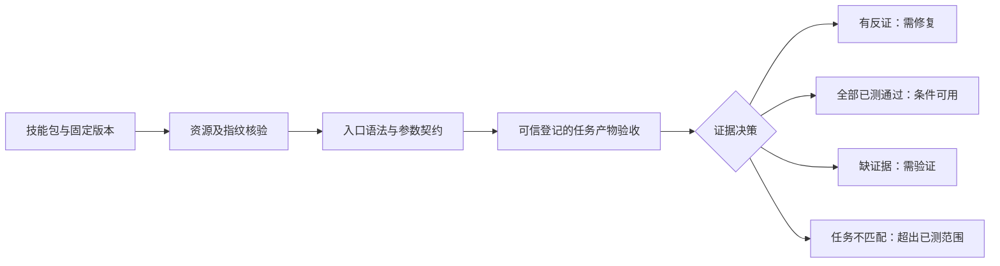

# 可核验的 Skill 优劣识别方法：首版成果与实测结果

日期：2026-11-11。用途：学位论文、课题汇报与导师审阅。新增付费模型调用：0；新增 API 费用：0。

## 1. 成果是什么

已经实现 **证据约束技能判别器 v1（实现修订 v1.2）**，源码包为 `research.skill_decision`。
它是“固定规则＋独立产物验收＋保守决策”的可运行方法，没有训练神经网络。
输入技能包、被评价版本和任务证据，输出问题位置、失败原因、已测能力边界及四种决定：

| 输出 | 含义 | 使用方式 |
|---|---|---|
| 发现需修复的问题 | 有具体版本冲突、接口冲突或匹配任务的失败产物 | 修复相应问题，再验证 |
| 在已测任务范围内通过 | 必需静态检查无冲突且已登记的独立任务验收全部通过 | 仅用于该版本和已测输入范围 |
| 证据不足，需进一步验证 | 没有足够证据判为可用，也没有确认的反证 | 补充材料、适配器或任务测试 |
| 当前任务超出已有测试范围 | 任务类型或具体输入没有匹配的执行证据 | 不把旧测试结果外推到新任务 |

这使“技能好坏”成为有明确条件的可用性判断。咨询型技能没有脚本不会被直接判差。
少数测试通过也不会被写成对所有任务永久有效。

可演示文件、逐次数据、对照与消融结果均已提供；它已经超出只描述概念和列统计表的阶段。
目前尚未得到经过独立人类语义金标准验证的“整个社区 Skill 整体质量分类模型”。

## 2. 方法具体怎样工作

**第一层，固定对象。** 核对清单、文件与 SHA-256。上游版本必须由可信来源登记；
直接扫描一个文件夹时只生成当前快照，不会把自行生成的哈希称作上游真实性证明。

**第二层，机械反证。** 只解析 Python AST，不导入社区代码。
对于受支持的字面 argparse 入口，检查选项、必填、枚举值、数值类型与入口语法。
复杂解析器和 `parse_known_args` 等宽松入口返回未知。
每条结论保存文档路径、行号、原文、文件哈希及相应参数声明。
普通资源提及无法解析只保留复核线索；只有被固定清单确认缺失的文件才构成缺失反证。

**第三层，行为核验。** 由可信运行器登记输出，验收器检查实际产物，而不接受脚本的 `success=True` 作为成功。
本轮只执行本项目自编、源码字节命中固定白名单的程序，不执行社区或模型生成的任意代码。
执行进程不继承 API 密钥。Windows 本地后端是受控子进程，不能被称为不可信代码沙箱。
Docker 后端具备无网络、只读挂载、非 root、无新增权限和资源上限；远程复现结果另行记录。

**第四层，决策。** 有确认反证即要求修复；全部必需检查和已登记行为套件通过，才允许“已测范围内通过”；
没有行为证据、存在必需未知项或新输入没有记录，则保留未知或超范围。
形式上，条件通过需要 `版本匹配 AND 静态条件已核验 AND 任务匹配 AND 完整产物通过`。
这里没有用平均文档分抵消关键条件失败，也没有为未知节点填写未经校准的可信概率。

## 3. 能力边界怎样规定

每个行为回执绑定包指纹、实际执行源码哈希、任务类型、输入哈希、输出集合哈希及逐输入通过数。
回执 ID 还须由可信运行器登记；随意提交一个声称“全通过”的 JSON 不会被默认接受。
哈希用于版本和内容完整性，不充当外部数字签名；受信任主机被攻破不在本原型保证范围内。

套件通过只描述固定测试输入。同为整数求和任务，若新输入 `[999]` 没有登记过的行为证据，
判别器仍输出“超出已测范围”。这表示尚未验证，不表示模型或程序不可能算对它。
后续若要认证一个更宽输入域，需要预先规定契约、覆盖策略和独立新任务验证，不能从这24个例子自行推得。

## 4. 已经做了哪些验证

### 4.1 已知缺陷的独立构造与按父配置留出

构造60个程序包配置，每个产生10个版本，共600例。
其中40个父配置属于开发侧，20个属于测试侧；同一父配置的变体不会跨侧。
七类缺陷是虚构参数、遗漏必填、非法枚举、错误数值类型、缺失入口、版本字节变化和入口语法错误；
另有正常版本、无害注释及未知工厂解析器。

CLI 真值参照直接由生成器声明构建标准库 argparse，**没有使用判别器的 AST 提取结果**。
文件和语法干预的标签来自已登记编辑操作。算法不接收缺陷标签；没有拟合测试阈值。
这60个配置是自建诊断材料，不是60个真实社区仓库，也不是独立人类语义标签。

测试侧200例包括140个已知缺陷、40个无害对照和20个超出当前分析范围的案例：

| 方法 | 缺陷检出 | 无害对照误报 | 保留未知 |
|---|---:|---:|---:|
| 原项目文档均分≥0.8的适配规则 | 0/140 | 0/40 | 0/200 |
| 完整证据约束判别器 | 140/140 | 0/40 | 60/200 |
| 标准库 argparse 接口检查 | 80/140 | 0/40 | 60/200 |
| 只核对参数名 | 20/140 | 0/40 | 60/200 |
| 静态证据门控 | 140/140 | 0/40 | 60/200 |
| 去掉行为验收 | 140/140 | 0/40 | 60/200 |
| 去掉参数契约核验 | 60/140 | 0/40 | 140/200 |
| 去掉版本/资源核验 | 100/140 | 0/40 | 100/200 |

完整方法检出140/140个已知缺陷，40个无害对照零误报。
这些变体只来自20个父配置，不能写成140个独立真实 Skill 或社区总体准确率100%。
标准库在四类参数缺陷上同样完整检出80例；完整方法额外检出的60例来自版本、文件和语法检查，
不能解释为参数解析算法超过标准库。
静态无缺陷的40例仍缺少行为证据，故与20个范围未知例一起保留为60例未知；没有自动升级为优秀。

原项目文档启发式产生的是排序分，本轮使用“均分≥0.8”的固定适配规则作诊断对照，
没有将其冒充生产系统原有的自动放行策略或发表版 SkillNet 的完整评价流程。

### 4.2 真正运行的行为案例

另自编12个实现，覆盖整数求和、保持首现顺序的完整行去重、有向图排序三个任务族。
每族包含一个正确实现、两个逻辑缺陷实现和一个只返回成功的占位实现。
每个实现运行24个输入，共288次实际产物执行；输入全集只有72个，不是288个独立技能。
同一任务族的说明文档完全相同。原项目文档启发式对12个实现均给出约0.92分。

| 实现 | 产物通过 | 判别器结论 |
|---|---:|---|
| sum_correct | 24/24 | 已测套件通过 |
| sum_abs | 1/24 | 观察到失败 |
| sum_drop_last | 1/24 | 观察到失败 |
| sum_stub | 0/24 | 观察到失败 |
| dedup_correct | 24/24 | 已测套件通过 |
| dedup_key | 1/24 | 观察到失败 |
| dedup_sort | 1/24 | 观察到失败 |
| dedup_stub | 0/24 | 观察到失败 |
| dag_correct | 24/24 | 已测套件通过 |
| dag_ignore_edges | 0/24 | 观察到失败 |
| dag_reverse | 6/24 | 观察到失败 |
| dag_stub | 0/24 | 观察到失败 |

| 方法 | 缺陷实现检出 | 正确实现放行 | 错误放行 | 未知 |
|---|---:|---:|---:|---:|
| 原项目文档均分≥0.8的适配规则 | 0/9 | 3/3 | 9 | 0 |
| 完整证据约束判别器 | 9/9 | 3/3 | 0 | 0 |
| 标准库 argparse 接口检查 | 0/9 | 3/3 | 9 | 0 |
| 只核对参数名 | 0/9 | 3/3 | 9 | 0 |
| 静态证据门控 | 0/9 | 0/3 | 0 | 12 |
| 去掉行为验收 | 0/9 | 0/3 | 0 | 12 |
| 去掉参数契约核验 | 9/9 | 3/3 | 0 | 0 |
| 去掉版本/资源核验 | 9/9 | 3/3 | 0 | 0 |

完整方法保留3/3个正确实现，识别9/9个有失败产物的实现。
只看文档或参数接口的适配规则会放行全部9个缺陷实现。
静态门控与去掉行为层的方法则保留12个未知，不会错误放行，但也无法确认任何一个正确实现。
因此本轮行为层的作用既包括阻止错误放行，也包括在固定套件内辨认通过者，不能由“全部拒绝”替代。

这是一项真值明确的自建行为诊断，不是12个自然社区 Skill 的盲测。
构造数据与验收仍共享研究者规定的任务语义；整数求和还共同依赖 Python 精确整数运算。
去重参照逐行比较与执行器的哈希去重不同；图排序验收检查节点和边约束，允许多种合法拓扑序。
尚不能由这些小样本推断真实任务的普遍准确率或零风险。

### 4.3 真实社区包应用

对冻结 D1 的200个原始包重新运行只读诊断，全部登记资源先核对指纹。
结果是1个包存在明确接口冲突，199个包仍缺少充分任务证据。
470条命令观察中134条静态一致、3条冲突、333条未知；79条入口未能解析的观察被计入未知而没有消失。

实际案例：`gh-claude-senior-ml-engineer-9b50c5`，源提交 `19392f7a08264ed00486a251f5b2098321771f94`。

- `SKILL.md:283`：`python scripts/model_deployment_pipeline.py --model model.pkl --target staging`。
- `SKILL.md:291`：`python scripts/rag_system_builder.py --config rag_config.yaml --analyze`。
- `SKILL.md:299`：`python scripts/ml_monitoring_suite.py --config monitoring.yaml --deploy`。

这三条命令的选项没有被相应脚本声明，同时遗漏脚本要求的参数。
判别器能指出具体文档与参数声明作为修复依据；不能据此声称整个包在所有任务上都差。
真实社区包没有完整的人类整体质量标签，故本轮**不报告真实社区整体准确率**。

## 5. 一个可以手工讲清楚的例子

若任务要求对 `[['b','2'],['a','1'],['b','3'],['b','2']]` 做完整行去重并保留首现顺序，
正确结果是 `[['b','2'],['a','1'],['b','3']]`。
仅按第一列去重的实现会误删 `['b','3']`，即使文档完整、参数正确、进程退出码为0，也不合格。
本轮 `dedup_key` 只有1/24次产物通过，故对整个固定套件要求修复。
这个例子解释了为什么“说明看起来好”与“具体任务真的做对”必须分别验证。

## 6. 为什么当前结果有可信依据，哪里仍不能相信

可信依据是版本与源码绑定、已知干预、独立声明参照、真实进程产物、逐字段验收、
父配置隔离、固定规则、全部对照及消融记录，以及可离线重算的4896条方法决定。
本轮没有用付费 Judge 自己打的分当真值，没有训练神经分类器，也没有声称自主发现通用好坏标签。

相对只看文档，它能识别文档不变而实现错误的反例；相对只查接口，它增加版本、资源与行为层；
相对全拒绝，它能在已有行为证据的固定范围内放行通过者；相对不带来源的总分，它保留可定位的修复依据。
这些是已验证的工程与测量增量，尚不足以宣称新的学习算法、SCI级原创性或超过所有已有评价方法。

主要证据缺口是独立语义人审、真实社区工具执行、跨来源和跨任务验证，以及成本/收益校准。
“未知”很多意味着当前方法覆盖有限，而不意味着已证明这些 Skill 不好。
按父配置留出也只约束自建变体，不能替代外部来源隔离。

## 7. 可直接用于汇报的表述

> 我们已实现一个零新增API费用的证据约束技能判别器，将包版本、接口契约与实际任务产物联合核验，
> 输出需修复、已测条件下通过、证据不足或超出已测范围，并保存来源及失败依据。
> 在20个父配置的构造测试侧，检出140个已知缺陷且40个无害对照无误报；
> 在12个自编实现的288次实际执行中，保留3个通过者、识别9个缺陷实现。
> 对200个真实社区包确认1个包的3条接口冲突，其余保留待验证。
> 当前成果是范围明确、可复算的方法原型，尚不是经过真实社区整体质量金标准验证的通用分类模型。

## 8. 怎么运行，下一步做什么

一键演示：`python -m research.skill_decision.demo`。
只读扫描：`python -m research.skill_decision.cli scan 技能包目录`。
离线复算：`python -m research.skill_decision.reproduce`。
程序与数据目录见本包 README；演示本身不再执行被测程序，也不调用API。

下一步先为真实社区技能建立任务验收适配器和独立语义标注，扩大有行为证据的技能数，
再检验这些判断能否改善实际选用结果。没有总体标签和足够执行证据前，暂不包装通用评分模型或网络优化胜利。

版本说明：保留最初v1与v2运行。最终v3运行使用相同构造用例，修正输入范围绑定、未解析入口计数，
并确保Windows执行源码按原始字节写入。多次本地复现和远程复现不重复算作独立任务样本。
原九页论文和此前真实API实验保留，不用新构造数据替换其历史结果。

离线复算状态：PASS；复算方法决定4896条，
重新验收实际产物288份。
